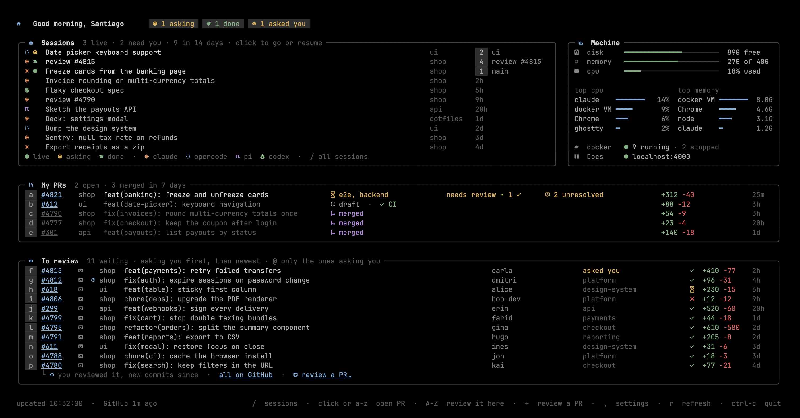

# deck

A terminal dashboard for your coding agents and your GitHub work, made for tmux window 0: the agents at
work and your sessions, your PRs, the reviews waiting for you, what GitHub has for you, and the machine.

## Install

Clone it and run `./install.sh`: it links `dash.py`, `agents-history.py`, `pr_review.py` and `branch_diff.py` into `~/.tmux/`, and turns on its gitleaks pre-commit hook. [These dotfiles](https://github.com/GuillenSanti/dotfiles) clone it into their `deck/` folder and run it for you, and bring what it relies on: the attention indicator that flags agents asking or done, the `prefix R` binding that reviews a PR, OSC 8 hyperlinks in `.tmux.conf`, and a tmuxp layout with the deck in window 0.

## What it shows

`dash.py`, linked as `~/.tmux/dash.py`, runs in window 0 (named with a home icon) of the tmux session and shows:



- **The greeting line**: next to the greeting, only what wants you now (the date is in tmux's status bar): agents asking or done, your PRs failing CI, with changes requested or conflicts, reviews asked of you directly, docker containers in trouble and a disk over 85% full. The counts the cards already show stay in the cards. Clicking the docker alert hides it until that container recovers (the Machine card still shows it), so one that stays broken doesn't keep the line busy.
- **Sessions**: first the live ones, the Claude Code, opencode and Codex panes at work, each with its CLI's icon, a green dot while it works, or a question mark (asking) or a bell (done) when it wants you (flagged by the attention indicator, those first), its title, folder and the window it's in; clicking one takes you to its pane. Then the newest of the other sessions of the last 14 days, read from each CLI's own files (`~/.claude/projects`, opencode's SQLite, `~/.pi/agent/sessions`, `~/.codex/sessions`): title (the `/rename` one when set), where, and age; clicking one resumes it in a new window in its folder (`claude --resume`, `opencode --session`, `pi --session`, `codex resume`). Files are read incrementally, only the lines added since the last read. `/`, or a click on the card's legend, opens `agents-history` in a popup.
- **`agents-history`** (`agents-history.py`, aliased in `.zshrc`): every session of every CLI in fzf, newest first, to find work from other days by title, folder, date or CLI. The preview shows where and when it ran, the resume command, and for Claude the prompts you typed (from `~/.claude/history.jsonl`). Enter goes to a live session's pane or resumes it in a new tmux window (in place outside tmux); `--print` only prints the command. What's been read of each session file is kept in `~/.cache/tmux-dash/session-index.json`, so opening it again reads only new lines. The session reading itself lives in `agent_sessions.py`, shared with the dashboard.
- **My PRs**: your open PRs in any repo, each with its repo's name, and its owner too when the list mixes owners (the config can leave out the ones you own, like these dotfiles), with CI (every check at its latest run, as GitHub's checks section shows it, plus the branch's required checks that haven't reported yet, naming the checks when only one or two are left or failing; a draft says so instead, keeping just whether CI passes), their place in the merge queue, whether they have every approval the repo needs, still need review, or have changes requested (and by whom), unresolved review threads, conflicts, auto-merge and size; and the ones merged in the last 7 days, with their size.
- **Inbox**: your unread GitHub notifications that talk to you: mentions of you first, then replies and activity on what's yours, then mentions of your teams (often a heads-up to all of it), the newest first in each. Each says who wrote and what: for a mention, the line that mentions you or your team (from the newest comment that does, or the description), else the last comment (or the PR or issue when nothing was said since); then the repo, the title and how long ago, at most 8 (`all on GitHub` for the rest). Only mentions, replies where you commented, and activity on what you opened or were assigned: review requests are To review's, and repos you only watch stay out. It's read-only: a notification goes once you read it on GitHub. Its letter or a click opens the comment, and a chip up top counts the mentions of you.
- **To review**: open PRs that ask you or one of your teams for a review, newest first (as many as the window has room for once the other cards are in, at least 3, so the whole dashboard fits; the ones past the keys go without one, their number and console icon still work), with their repo (and its owner when they mix owners), author, team (yours first, and how many more), CI and size. Requests from bots and CODEOWNERS broadcasts to more than 3 teams are hidden. A clock icon marks the ones you reviewed before and are asked to review again, in blue when there are commits since your review. `@` shows only the ones that ask you by name, and again everything. The console icon next to each one, or its letter in capitals, reviews it in the terminal: `pr_review.py` opens a `review #N` window with the PR's diff on the left (`gh pr diff` in diffnav, a file tree and each file's diff like GitHub's, set up by `diffnav/config.yml`; `n`/`N` jump between files, `s` switches to side by side, and after `q` ↑ Enter reloads it; in `less` when diffnav isn't installed) and the configured agent on the right, in your checkout of that repo. Claude is the default; Codex, OpenCode, and Pi can also be selected. If no checkout is found in `~/code/<repo>`, it asks you to clone the repo instead of opening an agent from your home folder. Claude resumes the PR's review when there is one (its session id comes from the PR's URL, and a review you started yourself with the URL in the prompt counts too), or goes to it while it's open. Other agents start a new interactive session. The prompt defaults to English; set a local prompt in the config to customize its instructions or language. The agent is told not to switch branches or post anything without showing you first. The icon turns green while its window is open. `review a PR…`, `+`, or `prefix R` from any window, asks for any PR in a popup (Esc closes it): its URL, its number, or `repo#number`.
- **Machine**: disk, memory and CPU from the same counters Activity Monitor reads, the apps using the most of each, docker, and the local apps you list in the config (see below).

It takes the whole window, as wide as it is but for a 4-column margin on each side, and as tall, with the footer at the bottom; Sessions and Machine share the top row when there's room. It only redraws while its window is on screen (every 5 s, every 30 s when the terminal app isn't focused; listening ports and docker, the costliest checks, every 30 s or on `r`), waits for tmux focus events instead of polling while hidden, and caches GitHub data from `gh` for 5 minutes (`r` refreshes it); when a fetch breaks it keeps what it had and writes why to `~/.cache/tmux-dash/errors.log`. Clicking a link opens it in the browser, and so does the letter next to a PR. The first 20 PRs get a letter of their own; after them a PR's key is two letters, `w`, `x`, `y` or `z` and then another (`wa`, `wb`…, 116 keys in all), and the footer shows the first one while it waits 3 s for the second (Esc drops it). Capitals review it in the terminal, as with one letter. Links are also OSC 8 hyperlinks, which need the `hyperlinks` terminal feature in `.tmux.conf` and a client attached after it was set. `dash.py --once` prints a single frame. `dash.py` lays the frame out, handles clicks and keys and runs the loop; the rest is in modules next to it: `dash_common.py` (settings and shared bits), `dash_ui.py` (colours, widths, cards), `dash_machine.py` (agents, sessions, CPU, memory, docker) and `dash_github.py` (PRs, CI, reviews), and each card is a module in `cards/`. Python finds them through the symlink, so only `dash.py` is linked into `~/.tmux`.

Each card is a module in `cards/`, and `~/.config/deck/config.json` picks which ones show and in what order. `false` hides a card, and the ones it doesn't mention show after the ones it lists, in the order below; without the file you get them all:

```json
{"cards": {"sessions": true, "machine": false, "my_prs": true, "to_review": true}}
```

The same file can choose the agent used for PR reviews and override the default English prompt. Supported agents are `claude` (the default), `codex`, `opencode`, and `pi`. Use `{url}`, `{repo}`, and `{number}` in a custom prompt for the PR details:

```json
{"review": {"agent": "claude", "prompt": "Review {repo}#{number} ({url}) in Spanish. Explain the purpose, approach, blockers, improvements, and verdict. Do not switch branches or post anything without showing me first."}}
```

The custom prompt replaces the default, so include any review criteria and safety instructions you want it to keep. You can also set the agent and prompt in `,` under Reviewing in the terminal; leave either empty to restore its default.

`,` opens the settings over the deck, each part saying what it's for and where it comes from: every card, on or off, with what it shows; whether My PRs shows your own repos; the organisations To review keeps to, yours from GitHub plus any you add by name; your repo and checkout; and the agent and prompt for reviews. Click the agent to choose from a list. Click the prompt to edit its full text in a modal; arrow keys move the cursor, Enter adds a line, Ctrl-O saves, and Esc cancels. The other text settings are typed in directly (Enter saves, empty clears them, Esc leaves the value as it was). Changes save to the config and apply at once; `,`, Esc or a click outside closes the settings. Machine goes next to the card before it when there's room, To review takes the lines the others leave, and the letters follow the order you read them in. A card brings its own data, alerts, keys (listed in the footer) and clicks, and can add to what other cards show (a few words in My PRs' rows, its own names for folders in Sessions), so turning it off drops all of that too. `cards/__init__.py` lists what a card module can have. Cards of your own go in `~/.config/deck/cards/`, next to the config, as a module or a folder with an `__init__.py`; the deck finds them there and lists them in the settings with the rest. A card that doesn't load, or breaks while it reads or draws, is left out or says so in its place, without taking the deck with it; what broke goes to `~/.cache/tmux-dash/errors.log`.

`branch_diff.py` shows what a checkout changes from main in diffnav, as the review windows show a PR's but without Claude: the branch's commits since it left `origin/main` plus what isn't committed yet, new files included (read-only, it never touches the index). After `q`, ↑ Enter reloads it. Run `~/.tmux/branch_diff.py` in any checkout, or let a card open it in its own window.

Machine also shows the local apps you list in the same file: each one with its `localhost` port while something listens on it, or as stopped while its `path` exists. `icon` is optional, a name from `ICON` in `dash_ui.py` or any Nerd Font glyph:

```json
{"apps": [{"name": "ngrok", "port": 4040, "icon": "tunnel"}, {"name": "Blog", "port": 4000, "path": "~/code/blog"}]}
```

Your main repo can go there too, as `repo` and `checkout` (the repo defaults to the checkout's `origin`). Then a PR's bare number, in `review a PR…` and `prefix R`, means one of its PRs, and its PRs are reviewed in that checkout. Both can be typed in from `,` too.

```json
{"repo": "acme/shop", "checkout": "~/code/shop"}
```

To review lists the review requests from every organisation, and knows which teams are yours in each of them; `orgs` keeps it to some. `my_prs` with `own_repos: false` leaves the PRs in the repos you own out of My PRs. Both can be set from `,` too:

```json
{"orgs": ["acme"], "my_prs": {"own_repos": false}}
```

It needs macOS (it reads the counters through libSystem), a Nerd Font and the system `/usr/bin/python3`. Paths default to this setup and can be changed with environment variables, for example in `~/.zshrc.local`. Whatever doesn't exist on a machine is left out:

| Variable | Default |
|---|---|
| `DECK_CONFIG` | `~/.config/deck/config.json` |
| `DASH_CONFIG` | Legacy alias, used only when `DECK_CONFIG` is unset |

To get it in the session, add this window to your tmuxp layout (`~/.tmuxp/main.yaml`; [the dotfiles](https://github.com/GuillenSanti/dotfiles) have one) and set the session's `base-index` to 0, so `renumber-windows` keeps it at 0:

```yaml
options:
  base-index: 0
windows:
  - window_name: 󰋜  # the Nerd Font home icon
    window_index: 0
    options:
      automatic-rename: false
    panes:
      - shell_command:
          - ~/.tmux/dash.py
```

## Keeping it public

`.githooks/pre-commit` stops a commit that adds a secret or a path into a home folder (`.gitleaks.toml`), and also the words in `../private/gitleaks.toml` when the deck sits in a dotfiles checkout with a private folder next to it. The Gitleaks workflow scans the full Git history on every push and pull request. A line that only looks like a secret says `gitleaks:allow`.
